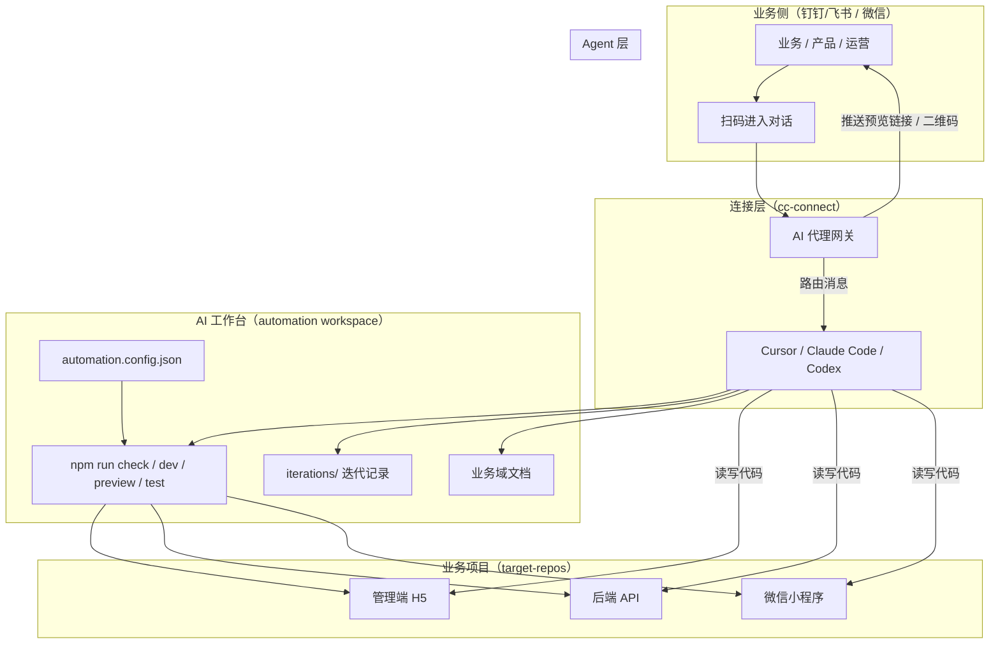
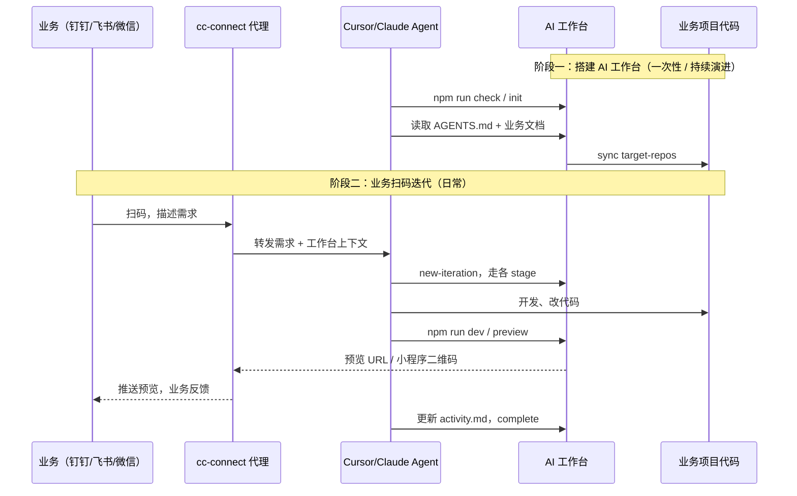

# 打造业务迭代代理，释放自身生产力

> 分享课件 · 2026-06
> 参考实践：`vist-customer-automation`（开放日预约系统 AI 工作台）｜ `sam-automation` (软件管理系统 AI工作台)
> 前置了解： cc-connect 

---

## 一、我们解决什么问题？

### 现状痛点

| 角色 | 典型困境 |
| --- | --- |
| **业务 / 产品** | 提需求靠口头或文档，等研发排期；改完看不到效果，反馈链路长；自身搭建研发环境困难、迭代不规范 |
| **研发** | 每次迭代重复解释业务背景、环境搭建、规范对齐；Agent 用了但「不可控、不可追溯」 |
| **团队** | Cursor / Claude Code / Codex 各自为战，缺少统一的迭代管控与留档 |

### 核心命题

> **把「AI 写代码」升级为「AI 驱动完整业务迭代」**——  
> 业务只需聊天提需求，通过代理在规范约束下完成设计 → 开发 → 预览 → 验证，全程可审计。

---

## 二、核心价值（Why）

### 1. 对业务：零门槛参与迭代

- 用 **钉钉/飞书 / 微信扫码** 即可与 AI 代理对话，无需安装 IDE、无需懂 Git
- 需求表达即触发完整迭代流程，**实时看到开发预览**（H5 / PC 浏览器 / 小程序真机扫码）
- 产品设计、UX 等关键节点仍保留 **人工确认**，避免 AI 自作主张

### 2. 对研发：释放重复劳动，保留掌控力

- **AI 工作台**统一管控：环境检查、研发规范、dev 模式、本地验证、迭代记录
- Agent（Cursor / Claude Code / Codex）在工作台约束下工作，**不是裸奔写代码**
- 每次迭代自动留档 `activity.md`，决策、阻塞、验证结果可追溯

### 3. 对组织：可复制的方法论

- 工作台与业务代码 **分离**：工具仓管流程，业务仓管产品代码
- `automation.config.json` 一次配置，多 Agent 共用同一套阶段与检查
- 从「个人效率工具」升级为 **团队级业务迭代基础设施**

### 价值公式

```
业务生产力释放 = （规范化的 AI 工作台 × 强编码 Agent）÷ 沟通与环境摩擦
```

---

## 三、整体架构



### 两层分工

| 层级 | 职责 | 典型产物 |
| --- | --- | --- |
| **AI 工作台** | 迭代管控、环境、规范、命令、留档 | `automation.config.json`、`iterations/`、`AGENTS.md` |
| **业务项目** | 真实产品代码 | `target-repos/admin`、`server`、`miniprogram` |
| **cc-connect 代理** | 把 IM 聊天桥接到 Agent + 工作台 | 钉钉/飞书/微信/auth2会话、预览推送 |
| **编码 Agent** | 理解需求、写代码、跑命令 | Cursor / Claude Code / Codex |

---

## 四、主流程讲解

### 流程总览（两阶段建设）



---

### 阶段一：围绕业务项目打造 AI 工作台

> 参考项目：`vist-customer-automation`  
> 路径：`/Users/xinyu.wang06/codelib/yuyueAI/vist-customer-automation`

#### Step 1.1 定义工作台与业务仓边界

- **工具仓**（automation workspace）：流程脚本、配置、迭代记录、Agent 规则
- **业务仓**（target-repos）：admin / server / miniprogram 等真实代码
- 工具仓 `.gitignore` 忽略 `target-repos/`，**业务提交在子仓内完成**

#### Step 1.2 编写 `automation.config.json`

核心配置块：

| 配置块 | 作用 |
| --- | --- |
| `project.targetRepositories` | 声明多仓映射（key、URL、子路径、角色） |
| `targetRepos` | 本地目录、同步策略、Agent 必读业务文档 |
| `stages` | check → init → 设计 → dev → test → commit → publish |
| `checks` | Node/Go/微信工具链、Git、依赖、业务文档完整性 |
| `records` | 迭代目录规范、`activity.md` 写入策略 |

#### Step 1.3 沉淀 Agent 指引

- `AGENTS.md` / `CLAUDE.md` / `.cursor/rules`：Agent 开工必读顺序
- `docs/business-domain-overview.md`：业务域总览
- `docs/business-repositories/*.md`：各端代码地图
- `docs/external-coordination.md`：权限、VPN、微信 AppID 等外部协作说明

#### Step 1.4 提供统一命令入口

```bash
npm run check              # 开工检查（工作台 + 业务环境）
npm run init               # 自动修复可处理项
npm run new-iteration -- "需求标题"
npm run dev -- --repos admin    # 启动本地 dev（策略可配置）
npm run preview            # 小程序真机预览（输出二维码）
npm run test               # 测试留档
npm run status             # 查看迭代状态
```

Cursor 内还可通过 `/check`、`/init`、`/start`、`/dev` 等斜杠命令触发。

#### Step 1.5 与 Cursor / Claude Code / Codex 配合

- 三类 Agent **共用同一工作台**，不各写一套流程
- Agent 通过读 `AGENTS.md` + `iterations/.active.md` 知道「当前在做什么」
- 阶段产物写入 `iterations/<id>/` 下对应 md 文件，形成 **可审计流水线**

---

### 阶段二：cc-connect 代理 + 业务扫码迭代

#### Step 2.1 cc-connect 的角色

**cc-connect** 是连接 **IM（钉钉/飞书 / 微信）** 与 **编码 Agent + AI 工作台** 的网关：

| 能力 | 说明 |
| --- | --- |
| 身份与会话 | 业务扫码绑定会话，无需 IDE 登录 |
| 消息路由 | 把自然语言需求转发给后端 Agent 进程 |
| 上下文注入 | 附带当前 active iteration、工作台路径 |
| 结果回传 | 预览链接、小程序二维码、阶段确认卡片推回 IM |

#### Step 2.2 业务侧典型交互

1. 业务在 钉钉/飞书 / 微信群扫 **项目专属二维码**
2. 发送：「给展厅预约小程序加一个分享功能，管理端能下载分享码」
3. 代理触发 Agent → 工作台 `new-iteration` → 走标准 stage
4. 产品设计阶段：代理推送设计摘要，业务回复「确认」或修改意见
5. 开发完成后：代理推送 **admin 本地预览 URL** 或 **小程序真机预览二维码**
6. 业务扫码体验 → 反馈「按钮太小」→ Agent 继续 dev → 再推送预览
7. 迭代 complete，全程记录在 `activity.md`

#### Step 2.3 实时开发预览的两条路径

| 端 | 预览方式 | 命令 / 机制 |
| --- | --- | --- |
| **管理端 H5** | 浏览器打开 `http://local.vist-admin.test:57000` | `npm run dev -- --repos admin` |
| **微信小程序** | 微信开发者工具 `cli preview` → 终端二维码 + 保存 PNG | `npm run preview` |

小程序预览前置条件（一次性）：
- 微信开发者工具已登录
- 设置 → 安全 → 开启「服务端口」
- 指定页面：`npm run preview -- --page pages/detail/index`

---

## 五、迭代阶段详解与注意点

### Stage 0：check / init — 开工检查

**做什么**  
验证工作台结构、运行时（nvm/Node/Go）、Git、业务仓同步、依赖安装、业务文档齐全。

**注意点**

| ⚠️ | 说明 |
| --- | --- |
| 先 check 再迭代 | Agent 默认 `npm run check`，失败则 `npm run init` 自动修复 |
| 外部阻塞要显式记录 | 权限、VPN、私有源、微信 AppID 等 **不静默跳过**，写入 `activity.md` |
| 后端 warning 策略 | 配置 `ifBackendCheckWarning: frontend-only`，避免后端挂掉阻塞前端 dev |

---

### Stage 1：pro design / ux design — 设计确认

**做什么**  
产出 `product-design.md`、`ux-design.md`（涉及 UI 时），业务确认范围与交互。

**注意点**

| ⚠️ | 说明 |
| --- | --- |
| **必须人工确认** | `requiresUserConfirmation: true`，代理不可自动跳过 |
| 范围写清 In/Out Scope | 避免 Agent 过度实现（参考「小程序分享功能」迭代） |
| cc-connect 场景 | 通过 IM 卡片推送摘要，业务回复「确认」即等价于点头 |

---

### Stage 2：technical design / use case — 技术方案与用例

**做什么**  
`technical-design.md`、`api-test-cases.md`、`e2e-test-cases.md`。

**注意点**

| ⚠️ | 说明 |
| --- | --- |
| 技术设计默认不需业务确认 | 但文档必须可查，方便研发 review |
| 用例驱动 test 阶段 | test stage 以用例为验收标准，失败则回 dev 重试 |

---

### Stage 3：dev — 开发与本地验证

**做什么**  
在业务仓切功能分支、写代码、本地编译验证、`activity.md` 记录每轮进展。

**注意点**

| ⚠️ | 说明 |
| --- | --- |
| 工具仓 vs 业务仓提交 | 代码 commit 在 `target-repos/<key>` 内，不在工具仓 |
| dev 启动策略 | 默认只启本次涉及前端；miniprogram 不自动启，需显式 `preview` |
| 阻塞要可恢复 | 如 Go 私有源、WX_APPSECRET 缺失——记录阻塞 + 已完成的代码，权限到位后继续 |
| 每阶段写 activity | `requireActivityBeforeStage` / `AfterStage` 保证可追溯 |

**参考案例**（vist-customer-automation / 小程序分享功能）：
- 三端并行改：miniprogram 分享 API + server 小程序码接口 + admin 下载 UI
- 后端编译因私有源 blocked，前端 tsc 已通过，阻塞项明确记录而非假装完成

---

### Stage 4：preview — 实时预览推送给业务

**做什么**  
启动 dev server 或调用微信 CLI 生成真机预览二维码，推送给业务扫码体验。

**注意点**

| ⚠️ | 说明 |
| --- | --- |
| 小程序 ≠ H5 | 必须走 `npm run preview`，不能假设浏览器能测小程序 |
| 二维码落盘 | 保存到 `iterations/<id>/miniprogram-preview-qr.png`，cc-connect 可转发 |
| 环境变量 | 如 `WX_QR_ENV=trial` 用于体验版小程序码 |
| 指定页面 | 复杂入口用 `--page` 或 `--compile-condition` |

---

### Stage 5：test — 测试留档

**做什么**  
按用例执行，产出 `test-report.md`；不通过则回 dev，或确认 external-blocker。

**注意点**

| ⚠️ | 说明 |
| --- | --- |
| 本地环境地址写死在 config | admin `57000`、API `57001`，Agent 与 test 脚本一致 |
| 外部阻塞 vs 代码 bug | 区分记录，避免无限 retry |

---

### Stage 6：commit / publish — 收尾与发布

**做什么**  
汇总变更、业务仓 commit；publish 按策略（当前 vist 项目为 local-only）。

**注意点**

| ⚠️ | 说明 |
| --- | --- |
| publish 需显式确认 | `requiresUserConfirmation: true` |
| 多仓发布顺序 | 先后端 / 前端 / 小程序，依赖关系写在 `external-coordination.md` |
| 不把 `.env` 提交或输出 | 敏感信息仅记录「需要配置什么」 |

---

## 六、关键设计原则（踩坑总结）

### 1. 工作台是「护栏」，不是「另一个项目」

- 业务代码永远在 target-repos，工作台只放流程与记录
- Agent 的所有动作应能映射到 `npm run *` 命令或 iteration 文件

### 2. 文档先于代码

- `bootstrap-business` 生成业务地图，Agent 迭代前必读
- 减少「Agent 每次从零摸索三端结构」的 token 与时间浪费

### 3. 阻塞要可见、可协作

- `activity.md` + `external-coordination.md` 是跨角色协作界面
- cc-connect 应把阻塞摘要推给业务，而非 Agent 悄悄卡住

### 4. 预览是闭环的关键

- 业务扫码看到效果 → 反馈 → 再改 → 再预览，形成 **分钟级迭代**
- H5 与小程序预览链路不同，配置里分开写

### 5. 多 Agent 兼容，单配置源

- Cursor rules、Claude Code、Codex 读同一套 `AGENTS.md` + config
- 未来 MCP 化（见 `docs/mcp-roadmap.md`）也复用同一 config，不 fork 流程

---

## 七、落地 checklist

### 搭建 AI 工作台

- [ ] 创建 automation workspace 仓库
- [ ] 编写 `automation.config.json`（stages / checks / targetRepos）
- [ ] 编写 `AGENTS.md` 与 Cursor rules
- [ ] 配置 target-repos 多仓映射与 sync 脚本
- [ ] 生成业务域文档（`bootstrap-business`）
- [ ] 跑通 `npm run check` → `new-iteration` → `dev` → `preview`

### 接入 cc-connect

- [ ] 部署 cc-connect 网关，绑定工作台路径
- [ ] 配置 钉钉/飞书 / 微信扫码入口与项目 QR
- [ ] 实现：需求转发、确认卡片、预览链接/二维码回传
- [ ] 权限边界：Agent 可读写业务仓，不可泄露 `.env`

### 试运行

- [ ] 选一个小需求（如 UI 微调）走通全链路
- [ ] 业务扫码预览并反馈
- [ ] 检查 `iterations/<id>/` 留档是否完整
- [ ] 复盘阻塞项，更新 `external-coordination.md`

---

## 八、参考项目速览

**项目**：`vist-customer-automation` — 米哈游开放日预约系统  
**业务三端**：

| 模块 | 路径 | 技术栈 |
| --- | --- | --- |
| 管理端 | `target-repos/admin` | React + Vite，端口 57000 |
| 后端 | `target-repos/server` | Go + Gin，端口 57001 |
| 小程序 | `target-repos/miniprogram` | 微信原生 |

**已验证迭代示例**：
- `iterations/20260626-1130-小程序分享功能/` — 三端联动 + 真机预览
- `iterations/20260625-1624-管理端展厅日期开放设置展示一个季度/` — 完整 stage 产物

**关键文件索引**：

```
vist-customer-automation/
├── automation.config.json    # 主配置
├── AGENTS.md                 # Agent 必读
├── commands/automation.mjs   # 命令实现
├── iterations/               # 迭代记录
├── docs/                     # 业务域 & 协作文档
└── target-repos/             # 业务代码（gitignore）
    ├── admin/
    ├── server/
    └── miniprogram/
```

---

## 九、总结

| 维度 | 传统模式 | 业务迭代代理模式 |
| --- | --- | --- |
| 提需求 | 文档 / 会议 / 排期 | 钉钉/飞书 / 微信聊天 |
| 开发 | 研发手动搭环境写代码 | Agent + 工作台自动化流水线 |
| 看效果 | 等部署 / 等测试环境 | 本地 dev + 真机扫码预览 |
| 留档 | 分散在 IM / PR / 口头 | `iterations/` 统一审计 |
| 研发角色 | 执行者 | **迭代管控者 + 规则制定者** |

> **一句话**：用 AI 工作台管住迭代质量，用 cc-connect 把业务拉进闭环，用 Cursor/Claude 释放编码产能——  
> 研发从「写每一行代码」转向「设计可复制的业务迭代基础设施」。

---

## 附录1：分享时可演示的 Command Demo

```bash
# 1. 开工
cd vist-customer-automation
npm run check

# 2. 新建迭代
npm run new-iteration -- "演示：首页 Banner 文案调整"

# 3. 启动管理端预览
npm run dev -- --repos admin
# → 浏览器打开 http://local.vist-admin.test:57000

# 4. 小程序真机预览
npm run preview
# → 终端二维码 + iterations/<id>/miniprogram-preview-qr.png

# 5. 查看状态
npm run status
```

## 附录2：业务与代理聊天
```text
# 可运行 /mode yolo


# 发起指令
预览小程序

# 发起迭代
改一下xxxx，加一个xxx

```

---


*课件版本 v1.0 · 基于 vist-customer-automation 实践整理*
